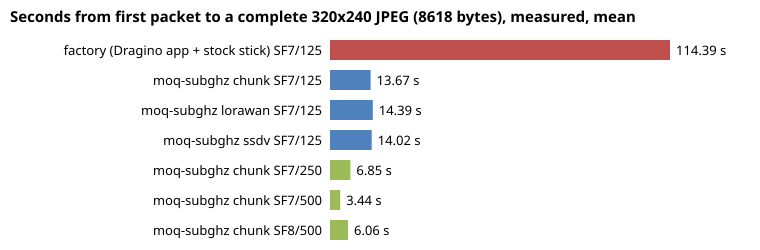
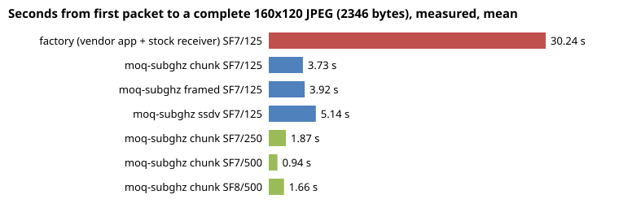

# moq-subghz on the CatWAN stick, `catwan-fw` 0.5.1: the full over-the-air benchmark

Everything marked **measured** came off the air on 2026-11-20 (about 01:00 to 02:20 Pacific), between the
same two radios as the [factory baseline](../factory-firmware/README.md): a Raspberry Pi 2 B with a Dragino
LoRa/GPS HAT sending, a CatWAN USB Stick RP2040 receiving. Everything marked **calculated** is from the SX1276
datasheet airtime formula. This test uses this project's firmware (`firmware/catwan-fw-0.5.1.uf2`) and Rust
tools at both ends. The factory test used neither.

**Wire version.** The wire version these captures used is not recorded in this README, and the
current tools speak version 5 (`VERSION` in `moq-subghz-wire/src/lib.rs`). Treat the captures as
supporting frame-size and airtime comparisons only. Any current loss or latency claim needs a
fresh run of the current tools.

## The short version

* **The stick works end to end on 0.5.1.** 72 still-picture runs and 8 live-video runs, all with the stick on
  0.5.1 and the radio reading `sx_version=0x12`. All 72 pictures came back complete. All 48 chunked-JPEG and
  LoRaWAN-framed pictures are byte for byte the sent JPEG.
* **Same radio settings as the factory test (SF7, 125 kHz), about 8 times the speed.** Timed the same way for both
  (first packet heard to complete picture), the 320x240 picture takes 13.7 s here against 114 s for the factory
  software, and the 160x120 picture 3.7 s against 30 s. Same chip, same
  packet size class, same bench. The factory pair spends most of its time in the Dragino app's per packet
  start-up, not on the air (see below).
* **Wider channels are faster.** SF7/500 sends the 320x240 picture in 3.4 s (20 kbit/s of picture data).
* **LoRa mode lost 0.16% of frames** (8 of 4932) in this test. The factory pair lost 8.8% on pass 1.
* **FSK live video** (300 kbit/s, 320x240, 15 fps) delivered 162 kbit/s of video at 137 ms median glass to glass.
  It lost about 10% of the video frames and about 1.3% of radio frames, more than the 2026-11-17 runs. The loss is
  not the new firmware, the signal level or the USB link; the cause is not found (see [FSK loss](#why-the-fsk-loss-is-higher-than-on-2026-11-17)).

## Setup

| | |
|---|---|
| sender | Raspberry Pi 2 B, Dragino LoRa/GPS HAT (SX1276), `moq-subghz-send` and `lora2015-send` (static armv7 builds of this repo's `main` at 0687416) |
| receiver | CatWAN USB Stick RP2040, `catwan-fw` 0.5.1 (`firmware/catwan-fw-0.5.1.uf2`), on a Linux host, `moq-subghz-recv` and `lora2015-log` |
| carrier | FSK 915.0 MHz. LoRa profiles: `sf7-125` 902.3 MHz, the others 903.0 MHz (see [lora-2015](../lora-2015/README.md)) |
| power | +5 dBm register setting (FSK also at +2 dBm). Not measured with a power meter. |
| link | antennas on both radios, indoors, a short distance apart, one fixed position for the whole run |
| time | the order was FSK first, then the picture sweep (3 repeats, interleaved), then two more FSK runs |

The two SVG charts and the contact sheets are drawn from those runs.

## Part 1: still pictures, the 2015 way, on the air (measured)

Each run sends one picture 3 times (3 passes), so a lost frame can arrive on a later pass. 4 radio settings x 3
modes x 2 pictures x 3 repeats = 72 runs, in the order rep 1 of everything, then rep 2, then rep 3.
"Seconds to picture" runs from the first frame heard to the last frame the picture needed, by the stick's
clock, plus one frame of airtime. "Goodput" is picture bytes divided by that. For SSDV the picture is the rebuilt
JPEG (SSDV re-encodes the picture, about 34 to 38 dB PSNR against the original, so it is smaller and a little different).
Frame loss counts frames that were sent in all three passes and never heard. Pass 1 loss counts chunks of the
picture not heard in the first pass. SNR is per packet from the stick. Raw data is in `lora/<run>/`.

| picture | setting | mode | frames | seconds to picture, mean (min to max) | airtime, calculated (s) | goodput (bit/s) | frame loss, all passes (%) | pass 1 loss (%) | RSSI (dBm) | SNR (dB) |
|---|---|---|---|---|---|---|---|---|---|---|
| 160x120 q20 | SF7/125 | chunk | 10 | 3.73 (3.73 to 3.73) | 3.73 | 5029 | 0.00 | 0.0 | -24 | 9.8 |
| 160x120 q20 | SF7/125 | lorawan | 10 | 3.92 (3.92 to 3.92) | 3.91 | 4785 | 0.00 | 0.0 | -25 | 9.8 |
| 160x120 q20 | SF7/125 | ssdv | 11 | 5.14 (4.41 to 6.61) | 4.40 | 4998 | 1.00 | 3.0 | -25 | 9.7 |
| 160x120 q20 | SF7/250 | chunk | 10 | 1.87 (1.87 to 1.87) | 1.86 | 10038 | 1.10 | 0.0 | -23 | 10.2 |
| 160x120 q20 | SF7/250 | lorawan | 10 | 1.97 (1.97 to 1.97) | 1.96 | 9549 | 0.00 | 0.0 | -23 | 10.2 |
| 160x120 q20 | SF7/250 | ssdv | 11 | 2.67 (2.21 to 3.61) | 2.20 | 9772 | 1.00 | 3.0 | -24 | 10.2 |
| 160x120 q20 | SF7/500 | chunk | 10 | 0.94 (0.94 to 0.95) | 0.93 | 19945 | 0.00 | 0.0 | -22 | 5.8 |
| 160x120 q20 | SF7/500 | lorawan | 10 | 0.99 (0.99 to 0.99) | 0.98 | 19034 | 0.00 | 0.0 | -22 | 5.9 |
| 160x120 q20 | SF7/500 | ssdv | 11 | 1.11 (1.11 to 1.11) | 1.10 | 22374 | 0.00 | 0.0 | -22 | 5.8 |
| 160x120 q20 | SF8/500 | chunk | 10 | 1.66 (1.66 to 1.66) | 1.65 | 11326 | 0.00 | 0.0 | -24 | 7.0 |
| 160x120 q20 | SF8/500 | lorawan | 10 | 1.74 (1.74 to 1.74) | 1.73 | 10792 | 0.00 | 0.0 | -24 | 6.9 |
| 160x120 q20 | SF8/500 | ssdv | 11 | 1.95 (1.95 to 1.95) | 1.94 | 12682 | 0.00 | 0.0 | -24 | 7.0 |
| 320x240 q10 | SF7/125 | chunk | 35 | 13.67 (13.67 to 13.67) | 13.64 | 5043 | 0.33 | 0.0 | -24 | 9.8 |
| 320x240 q10 | SF7/125 | lorawan | 36 | 14.39 (14.38 to 14.39) | 14.36 | 4792 | 0.00 | 0.0 | -25 | 9.8 |
| 320x240 q10 | SF7/125 | ssdv | 35 | 14.02 (14.02 to 14.02) | 13.99 | 5070 | 0.00 | 0.0 | -25 | 9.8 |
| 320x240 q10 | SF7/250 | chunk | 35 | 6.85 (6.85 to 6.85) | 6.82 | 10069 | 0.33 | 0.0 | -24 | 10.3 |
| 320x240 q10 | SF7/250 | lorawan | 36 | 7.21 (7.21 to 7.21) | 7.18 | 9562 | 0.00 | 0.0 | -23 | 10.1 |
| 320x240 q10 | SF7/250 | ssdv | 35 | 7.02 (7.02 to 7.02) | 6.99 | 10119 | 0.33 | 0.0 | -23 | 10.2 |
| 320x240 q10 | SF7/500 | chunk | 35 | 3.44 (3.44 to 3.44) | 3.41 | 20059 | 0.00 | 0.0 | -22 | 5.9 |
| 320x240 q10 | SF7/500 | lorawan | 36 | 3.62 (3.62 to 3.62) | 3.59 | 19058 | 0.00 | 0.0 | -22 | 5.9 |
| 320x240 q10 | SF7/500 | ssdv | 35 | 3.52 (3.52 to 3.52) | 3.50 | 20163 | 0.00 | 0.0 | -22 | 5.9 |
| 320x240 q10 | SF8/500 | chunk | 35 | 6.06 (6.06 to 6.06) | 6.03 | 11372 | 0.00 | 0.0 | -24 | 7.0 |
| 320x240 q10 | SF8/500 | lorawan | 36 | 6.38 (6.38 to 6.38) | 6.35 | 10811 | 0.30 | 0.0 | -24 | 7.0 |
| 320x240 q10 | SF8/500 | ssdv | 35 | 7.67 (6.21 to 10.59) | 6.19 | 9857 | 0.33 | 1.0 | -24 | 7.0 |

How to read it: the measured seconds match the calculated airtime to within 1% when nothing is lost,
so the link, the stick and the loggers add no delay worth naming (the largest gap is 0.8%, on a 1 s picture). Where one frame was lost (a run with a
larger mean than its minimum), the picture waits for the next pass.

Whole sweep: 72 runs, 4932 frames sent, 4924 heard, 8 lost (0.16%), 3 of 1644 first-pass chunks missed (0.18%),
no frame arrived corrupted, RSSI -41 to -19 dBm, SNR about 5 to 10 dB (lower on the 500 kHz profiles, which
take more noise).





`gallery/large-320x240-reassembled.png`: the 12 reassembled 320x240 pictures of repeat 1 (rows: chunk, SSDV,
LoRaWAN-framed; columns: SF7/125, SF7/250, SF7/500, SF8/500). They look the same because they are the same
picture; the chunk and LoRaWAN ones are identical to the file that was sent.

**LoRaWAN-framed, no network.** The `lorawan` rows are correct LoRaWAN 1.0 uplink bytes with published test keys
and no gateway, join or network server, on a private sync word. A real LoRaWAN gateway would not hear it. They show
what the extra 13 bytes cost, not what a LoRaWAN network does.

## Part 2: factory software against moq-subghz, side by side

Same chip, same settings (SF7, 125 kHz, coding rate 4/5, CRC on), same two pictures, same bench. The factory
carrier is 915.0 MHz and moq-subghz `sf7-125` is 902.3 MHz. The factory numbers are from
[`../factory-firmware/results.csv`](../factory-firmware/results.csv) (3 runs per picture, measured 2026-11-20 earlier
the same day).

| picture | stack | runs | pass 1 loss (%) | packets per picture | seconds to picture, mean (min to max) | goodput (bit/s) | RSSI (dBm) | SNR (dB) |
|---|---|---|---|---|---|---|---|---|
| 160x120 q20, 2346 B | factory: Dragino sample app + stock stick image | 3 | 5.0 | 20 | 30.2 (25.6 to 33.2) | 629 | -36 | not reported |
| 160x120 q20, 2346 B | moq-subghz 0.5.1, chunk | 3 | 0.0 | 10 | 3.73 (3.73 to 3.73) | 5029 | -24 | 9.8 |
| 160x120 q20, 2346 B | moq-subghz 0.5.1, LoRaWAN-framed | 3 | 0.0 | 10 | 3.92 | 4785 | -25 | 9.8 |
| 160x120 q20, 2346 B | moq-subghz 0.5.1, SSDV | 3 | 3.0 | 11 | 5.14 (4.41 to 6.61) | 4998 | -25 | 9.7 |
| 320x240 q10, 8618 B | factory: Dragino sample app + stock stick image | 3 | 9.3 | 72 | 114.4 (108.1 to 122.8) | 604 | -37 | not reported |
| 320x240 q10, 8618 B | moq-subghz 0.5.1, chunk | 3 | 0.0 | 35 | 13.67 (13.67 to 13.67) | 5043 | -24 | 9.9 |
| 320x240 q10, 8618 B | moq-subghz 0.5.1, LoRaWAN-framed | 3 | 0.0 | 36 | 14.39 | 4792 | -25 | 9.8 |
| 320x240 q10, 8618 B | moq-subghz 0.5.1, SSDV | 3 | 0.0 | 35 | 14.02 | 5070 | -25 | 9.8 |

"Seconds to picture" is timed the same way for both stacks: from the first packet of the picture heard to the
packet that completes it, plus one packet of airtime. For the factory runs that is recomputed from the receive times in
`../factory-firmware/data/*/stick.packets.csv` (host clock; moq-subghz uses the stick's clock). The factory script's own
`end_to_end_s` (34.8 and 118.9 s) also counts setup and a fixed 2 s wait after every pass, so it is not compared here; an
earlier version of this table did, and gave 9.3 and 8.7 times. The factory window still includes its harness's gap
between passes (about 3 s and an scp per extra pass, against 1 s for moq-subghz), so the ratios below are slightly
generous to moq-subghz.

Measured, from the table: moq-subghz chunked at SF7/125 is 8.1 times faster for the small picture and 8.4 times
faster for the large one. Where the time goes (calculated from the factory README): one factory packet is 389 ms on air
and takes 1.34 s from the Pi, so the sender is on the air about 30% of the time. Here the sender is on the air
58 to 95% of the time (`duty_pct` in `lora/*/send.txt`, calculated airtime over wall time). The packets are also bigger (255 B of raw bytes against 120 B of JPEG
sent as 250 characters of hex text), which is most of the rest.

The signal was a little stronger in this test (about -25 dBm against -37). The factory pair lost frames at -37 dBm too, and
the loss was not about weak signal there either, so the 12 dB is not what explains the difference in loss. This test cannot say why the
factory pair lost more.

Not the same thing, measured on the same bench: the **FSK live video** below moves 162 kbit/s of H.264. The factory pair moves about 0.55 kbit/s of JPEG,
so the FSK path is about 300 times the data rate (calculated from the two measured numbers).

## Part 3: FSK live video, 300 kbit/s (measured)

`moq-subghz-bench run` as in [results/video](../video/README.md), 120 s per run: 320x240, 15 fps, GOP 15, x264 at 180 kbit/s,
96 B minimum frame, profile `300000:100000:6`, with the clock check before and after. Means over the runs:

| runs | setting | radio frame loss (%) | objects lost (FEC could not repair) | video frame loss (%) | video delivered (kbit/s) | radio goodput (kbit/s) | obj latency p50 / p95 (ms) | glass to glass p50 / p95 (ms) | stalls over 250 ms | RSSI (dBm) |
|---|---|---|---|---|---|---|---|---|---|---|
| 4 | FEC k=8, +5 dBm | 1.31 | 41 | 10.3 | 162.2 | 223.7 | 68.9 / 173.6 | 136.7 / 243.7 | 12.5 | -15 |
| 2 | FEC k=8, +2 dBm | 1.17 | 32 | 10.2 | 161.5 | 223.0 | 68.5 / 172.5 | 136.1 / 240.6 | 14.5 | -17 |
| 1 | no FEC, +5 dBm | 1.20 | 88 | 19.8 | 145.2 | 191.8 | 65.3 / 147.7 | 133.4 / 218.4 | 20 | -10 |
| 1 | FEC k=8, +5 dBm, rind ChaCha20-Poly1305 | 1.24 | 33 | 8.8 | 163.8 | 225.9 | 68.8 / 180.4 | 136.9 / 248.9 | 10 | -12 |

* **Latency matches the 2026-11-17 runs** (about 135 ms glass to glass, the project's headline number). Latency is from the barcode in the picture and
  the clock check between the two machines (offset 7 to 9 ms), not from a stopwatch. g2g includes the one frame the ffmpeg decoder holds.
* **FEC halves the damage:** about 58 radio frames were repaired per 120 s by FEC k=8, and video frame loss was 10% against 20% without it.
* **Encryption costs nothing visible:** no authentication failures, and the same loss and latency.
* The run files are in `fsk/<run>/` (summaries, per object logs, the stick's serial log). `fsk-live-120s.mp4` is the received stream
  of `f300-fec8-p5-1`, as received, with the glitches in it. `fsk-live-still.png` is one frame of it.


### Why the FSK loss is higher than on 2026-11-17

The 2026-11-17 runs lost 0.5% of radio frames and 4.5% of video frames at 300 kbit/s. These lost 1.3% and 10%. What was tried:

| check | result |
|---|---|
| firmware: flash `catwan-fw-v5.uf2` (0.5.0) back onto the stick and repeat (3 x 120 s, [`fsk-v5-ab.csv`](fsk-v5-ab.csv)) | 1.13% radio loss and 9.2% video loss. Same as 0.5.1, so the new firmware is not the cause. The stick was put back on 0.5.1 afterwards. |
| signal level: +2 dBm against +5 dBm, and RSSI that wandered from -10 to -17 dBm | the loss did not change, so it is not too weak and not an overloaded receiver. |
| USB or the host: the stick counts the frames it passes on | its count equals the frames the receiver parsed, and the receiver's CPU was under 1%. Not lost between the stick and the program. |
| bursts: when the missing objects happened | spread over the run, mostly single objects (23 single, 7 pairs, 2 triples in one run), not one long outage. |
| the stick's own receive errors | 15 to 31 per run, so most missing frames were never reported by the stick at all. |

What is different from 2026-11-17: the host (a different computer and cable), the antenna positions (RSSI is -10 to -17 dBm here and was -38 dBm
then), and the room. LoRa mode on the same stick and antennas lost 0.16%, so the position is not hostile to the radio in general. **The cause is not found.** The likely suspects are
the closer antennas and the host, and the next test is the same run with the antennas about 1 m apart as in
`results/video`. That needs someone to move the antennas.

## Run it again

The demo script does a short version in about 6 minutes: stick and Pi checks, 45 s of live FSK video, then one small picture three ways at
SF7/500 and SF7/125. The same steps by hand are in [HOWTO](../../HOWTO.md) and [lora-2015](../lora-2015/README.md).

```sh
cargo build --release                                  # host tools
cargo build --release --target armv7-unknown-linux-musleabihf -p moq-subghz-send -p moq-subghz-recv -p moq-subghz-lora2015
scp target/armv7-unknown-linux-musleabihf/release/{moq-subghz-send,moq-subghz-recv} PI:moq-subghz/
scp target/armv7-unknown-linux-musleabihf/release/lora2015-send PI:lora2015/ && scp -r results/lora-2015/frames PI:lora2015/
export PORT=/dev/ttyACM0 PI=pi             # the stick must report catwan-fw 0.5.1; add --no-play when ffplay is not installed
export PATH="$PATH:/path/to/ssdv"          # optional: the ssdv tool, for the SSDV pictures
B=target/release/moq-subghz-bench
$B demo-051 --i-have-an-antenna --transmit             # about 6 minutes, writes to runs/demo
```

The full benchmark (about 65 minutes): `moq-subghz-bench bench-051 --i-have-an-antenna --transmit`. Then `moq-subghz-bench package-051 RUNS DEMO_DIR results/stick-0.5.1` and
`moq-subghz-bench analyze RUNS results/stick-0.5.1` rebuild this folder's CSVs and charts. `--part lora --reps 1` runs one repeat of the picture sweep (about 15 minutes).

| subcommand | what |
|---|---|
| `lora2015-run` | one picture run: logger here, sender on the Pi, then the exact loss from a replay |
| `bench-051` | the whole matrix (FSK runs, then 3 repeats of the 24 picture runs) |
| `demo-051` | the short demo |
| `analyze` | builds the CSVs and charts from the runs (ffmpeg for the SSDV PSNR) |
| `package-051` | copies the data worth keeping into this folder, without host paths |

To read a run again without the radio: `gunzip -k lora/RUN/raw.log.gz`, then
`lora2015-log --replay lora/RUN/raw.log --mode MODE --profile PROFILE --sent-frames N --out OUT` (N is in `lora/RUN/send.txt`).

## Files

| file | what |
|---|---|
| `lora.csv` | one line per picture run (72), every column of this README and more |
| `lora-summary.csv` | the table above |
| `compare.csv` | factory against 0.5.1 at SF7/125 |
| `fsk.csv`, `fsk/` | the 8 live video runs, and their logs |
| `fsk-v5-ab.csv`, `fsk-v5-ab/` | the 3 runs on the previous firmware |
| `lora/` | per run: `images.csv`, `rx.csv` (every frame: time, RSSI, SNR, chunk, status), `tx.csv` (the Pi's per frame log), `raw.log.gz`, the rebuilt picture |
| `demo/` | one run of `demo-051`: a 45 s clip, a still, and the pictures |
| `gallery/` | contact sheets of the rebuilt pictures |

## Limits

* One bench, one antenna pair, a short distance. No range test, no interference test, no obstacles. The signal is strong, which is why loss is so low in LoRa mode.
* Output power was not measured; +5 dBm is the register setting.
* "Latency" for pictures is time to a complete picture. There is no per frame clock link between the Pi and the host for the picture runs.
* Pass 1 loss is read from chunk order. A lost whole pass would not show in it, and none happened.
* The factory and moq-subghz LoRa tests were on different carriers (915.0 and 902.3 MHz) and the signal differed by about 12 dB.
* The cause of the FSK loss is open.
* Not LoRaWAN: no join, no gateway, no network server.

(Written by Grok Bot)
